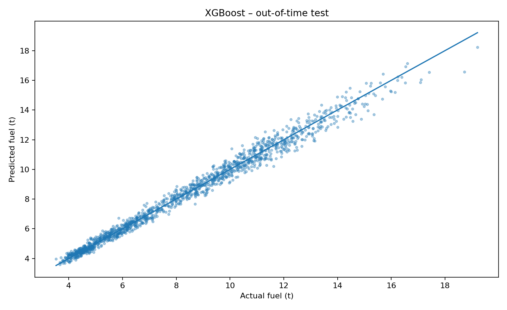
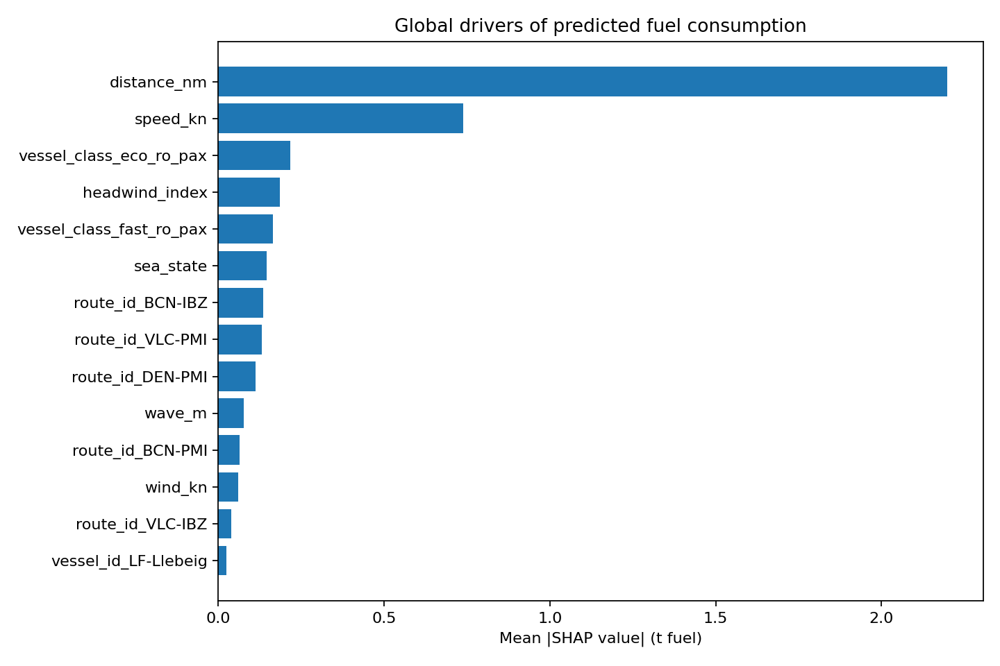
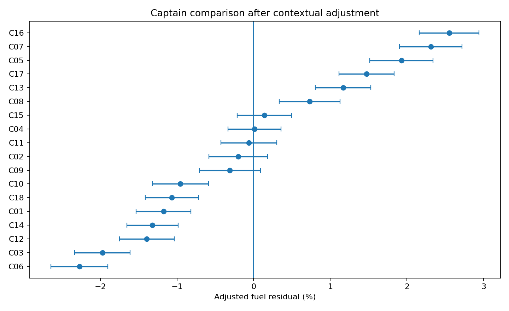
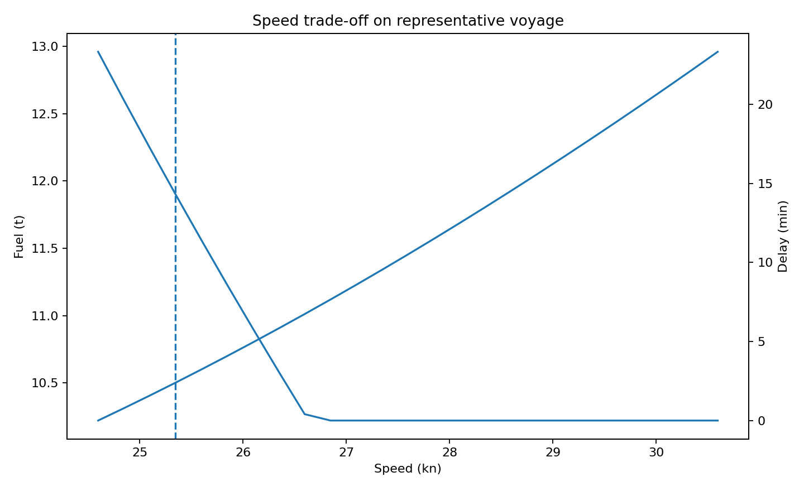

# Levante Ferries — Fuel Efficiency & Voyage Optimization


**Proyecto 8 · Business Analytics / Data Science / Operaciones marítimas**

Sistema de analítica para estudiar la eficiencia de combustible y apoyar decisiones de velocidad por viaje en una compañía ficticia de ferries: **Levante Ferries**.

El proyecto conecta consumo, meteorología, carga, buque, puntualidad, emisiones y margen. Combina clustering, predicción con XGBoost, explicabilidad SHAP, comparaciones ajustadas al contexto y simulación económica.

> **Todos los datos son sintéticos. No representan a una naviera, operación ni persona real.** Los resultados muestran cómo funciona la metodología en este caso de portfolio.

---

## Herramientas interactivas

- [Dashboard publicado y simulador](https://www.amlacasta.tech/proyectos/fuel_efficiency/dashboard/).
- [Página del Proyecto 8](https://www.amlacasta.tech/proyectos/fuel_efficiency/).
- [Portfolio completo](https://www.amlacasta.tech/).
- [Dashboard HTML para descargar](dashboard/index.html).
- [Dosier explicativo en Word](docs/Dossier_Proyecto_8_Levante_Ferries.docx).

El dashboard permite revisar indicadores y resultados por ruta, consultar comparaciones ajustadas y modificar velocidad, precio del combustible, precio EUA y estado de la mar. El simulador recalcula combustible, CO₂e, retraso, cumplimiento de OTR15, coste ETS analítico y margen.

GitHub muestra el código de los HTML. Para utilizarlos, abre la versión publicada o descarga el repositorio y abre `dashboard/index.html` en tu navegador.

---

## Resumen ejecutivo

| Indicador | Resultado del caso sintético |
|---|---:|
| Viajes | 7.200 |
| Rutas | 8 |
| Buques | 10 |
| Capitanes con identificadores sintéticos | 18 |
| Combustible total | 58.665,31 t |
| Emisiones modelizadas | 183.660,21 tCO₂e |
| Coste de combustible | 40,46 M€ |
| Coste ETS analítico | 14,28 M€ |
| Margen agregado del caso | 296,51 M€ |
| OTR15 | 83,60 % |
| Intensidad de combustible | 81,89 kg/milla náutica |
| Intensidad de emisiones por pasajero | 36,00 kgCO₂e/pax |
| XGBoost · MAE | 0,279 t/viaje |
| XGBoost · RMSE | 0,374 t/viaje |
| XGBoost · R² | 0,986 |
| XGBoost · WAPE | 3,37 % |
| Silhouette del clustering | 0,485 |

Fuente: [resumen ejecutivo](outputs/tables/executive_summary.json) y [métricas del modelo](outputs/tables/model_metrics.json).

### Lectura de negocio

Reducir velocidad modifica simultáneamente el consumo de propulsión, el tiempo de navegación y el consumo auxiliar. El ahorro potencial debe contrastarse con el horario y el margen. Comparar consumo bruto entre viajes tampoco permite evaluar eficiencia sin considerar ruta, buque, carga y meteorología.

Las métricas predictivas se obtienen sobre datos sintéticos generados con relaciones conocidas. Su precisión no implica que el modelo vaya a rendir igual con datos reales.

---

## 1. Problema de negocio

El combustible afecta tanto al coste operativo como a las emisiones de cada viaje. Una decisión basada únicamente en toneladas consumidas puede ocultar diferencias de distancia, capacidad transportada, condiciones de navegación o tipo de buque.

La pregunta central es:

> ¿Cómo reducir combustible y emisiones por viaje sin deteriorar la puntualidad ni el margen?

El proyecto permite estudiar qué viajes consumen más de lo esperado para su contexto y qué velocidades resultan económicamente preferibles dentro del límite de puntualidad modelizado.

## 2. Preguntas y decisiones

| Pregunta | Análisis | Decisión que ayuda a preparar |
|---|---|---|
| ¿Dónde se concentra el consumo? | KPIs por ruta y buque | Priorizar corredores para investigar |
| ¿Qué viajes son comparables? | Clustering y ajuste de contexto | Seleccionar grupos de análisis |
| ¿Cuánto combustible cabe esperar? | XGBoost con test temporal | Detectar desviaciones del consumo esperado |
| ¿Qué explica la predicción? | SHAP | Investigar variables asociadas al consumo |
| ¿Hay diferencias consistentes tras el ajuste? | Residuos, estratos e IC95% | Plantear revisión de prácticas operativas |
| ¿Qué ocurre al modificar velocidad y precios? | Simulación de sensibilidad | Contrastar coste, servicio y margen |

## 3. Datos y unidad de análisis

Cada fila representa un **viaje sintético**. La base contiene 7.200 viajes, 8 rutas y 10 buques.

| Grupo | Variables principales |
|---|---|
| Viaje y tiempo | Identificador, fecha, hora, ruta y distancia |
| Buque | Identificador, clase, capacidad de pasajeros y metros lineales |
| Carga | Pasajeros, metros lineales utilizados, ocupación y carga estimada |
| Navegación | Velocidad, estado de la mar, oleaje, viento y corriente |
| Servicio | Tiempo de navegación, demora portuaria, retraso y OTR15 |
| Consumo y carbono | Combustible, CO₂ y CO₂e modelizados |
| Economía | Precio del combustible, EUA, ingresos, costes y margen |
| Comparación | ID sintético de capitán y residuos ajustados |

Los catálogos y la generación se encuentran en [src/project8.py](src/project8.py). La semilla reproducible es `20261009`.

## 4. Arquitectura analítica

1. Generación y controles de datos.
2. Exploración de consumo, puntualidad y economía.
3. Clustering de regímenes operativos.
4. Predicción de combustible y evaluación temporal.
5. Explicación del modelo mediante SHAP.
6. Comparación de residuos con ajuste de contexto.
7. Simulación de velocidad, carbono y margen.
8. Consolidación de KPIs y herramientas ejecutivas.

## 5. Notebooks

| Notebook | Finalidad | Resultado principal |
|---|---|---|
| [00 · Generación](notebooks/00_data_generation.ipynb) | Construir la base sintética reproducible | Viajes y catálogos |
| [01 · Calidad y EDA](notebooks/01_data_quality_eda.ipynb) | Revisar rangos, claves y coherencia | Controles y diagnóstico inicial |
| [02 · Clustering](notebooks/02_voyage_regimes_clustering.ipynb) | Identificar regímenes operativos | Grupos y perfiles medios |
| [03 · XGBoost](notebooks/03_xgboost_fuel_model.ipynb) | Estimar combustible esperado | Predicciones y métricas temporales |
| [04 · SHAP](notebooks/04_shap_explainability.ipynb) | Explicar factores del modelo | Importancia de variables |
| [05 · Comparaciones ajustadas](notebooks/05_context_adjusted_comparisons.ipynb) | Analizar diferencias tras controlar contexto | Residuos, soporte e IC95% |
| [06 · Simulador](notebooks/06_speed_fuel_punctuality_ets_margin_simulator.ipynb) | Comparar velocidades y viabilidad bajo OTR15 | Escenarios y alternativa seleccionada |
| [07 · KPIs y validación](notebooks/07_executive_kpis_and_validation.ipynb) | Consolidar resultados ejecutivos | Indicadores y comprobaciones |

Los notebooks incluyen las salidas del caso aportado. La preparación para este repositorio conserva esas salidas y adapta la localización de la raíz del proyecto para ejecutarlos desde la carpeta `notebooks` o desde la raíz.

## 6. Metodología

### Clustering

K-Means identifica cinco grupos utilizando velocidad, distancia, combustible y retraso estandarizados. Es un análisis descriptivo de regímenes observados; los grupos incluyen resultados del viaje y no deben interpretarse como una clasificación predictiva disponible antes de zarpar.

### Predicción del consumo

XGBoost utiliza variables de ruta, buque, carga, meteorología, velocidad y hora. El identificador del capitán no entra en el modelo. La evaluación separa temporalmente 5.760 viajes de entrenamiento y 1.440 de prueba.



### Explicabilidad

SHAP descompone la predicción en contribuciones de las variables del modelo. Estas contribuciones ayudan a interpretar asociaciones aprendidas y no demuestran efectos causales.



### Comparación ajustada

Se obtienen predicciones fuera de muestra con cinco particiones y se calcula el residuo porcentual de combustible. Como contraste, se revisan estratos de buque, ruta, carga, mar y viento.

El soporte requiere al menos 120 viajes y un score de 0,60. Los intervalos del caso son aproximaciones basadas en el error estándar de los residuos; no corrigen toda la dependencia temporal ni eliminan variables omitidas. La validación de esta comparación usa KFold aleatorio y debe distinguirse del test temporal del modelo predictivo.



Los IDs representan perfiles completamente sintéticos. Las diferencias sirven para plantear hipótesis de revisión operativa y no justifican un ranking de desempeño ni decisiones laborales.

## 7. KPIs y fórmulas

| KPI | Cálculo o definición |
|---|---|
| Combustible por viaje | Toneladas consumidas en el viaje |
| Intensidad de combustible | `Σ combustible_t × 1.000 / Σ distancia_nm` |
| CO₂e por pasajero | `Σ CO₂e_t × 1.000 / Σ pasajeros` |
| OTR15 | `100 × viajes con retraso ≤ 15 min / viajes totales` |
| Retraso | `máximo(tiempo total − tiempo programado, 0)` |
| Coste de combustible | `combustible_t × precio_€/t` |
| ETS analítico del caso | `CO₂e_t × precio_EUA` |
| Margen | `ingresos − combustible − ETS − otros costes` |
| Residuo ajustado | `100 × (consumo real − consumo esperado) / consumo esperado` |
| WAPE | `100 × Σ error absoluto / Σ consumo real` |

Los indicadores de intensidad agregados se calculan como cocientes de sumas para conservar el peso de cada viaje.

## 8. Simulador y optimización

El notebook explora velocidades en pasos de 0,25 nudos y selecciona el mayor margen entre las alternativas que cumplen OTR15. Si ninguna cumple, el código devuelve una alternativa del conjunto completo: debe tratarse como **no factible**, no como una recomendación que preserve puntualidad.

El simulador HTML aplica una aproximación cúbica de la potencia de propulsión, ajustada por duración y contexto, y añade consumo auxiliar. Permite modificar:

- Velocidad: 16–30 nudos.
- Combustible: 500–1.000 €/t.
- EUA: 40–130 €/tCO₂e.
- Estado de la mar: 0–5.

**El dashboard utiliza fórmulas de sensibilidad; no ejecuta XGBoost ni el optimizador Python en el navegador.** Su caso ilustrativo fija 88 millas náuticas, 185 minutos de horario y 8 minutos de demora portuaria. No debe confundirse con el viaje seleccionado por el notebook.



## 9. Estructura del repositorio

| Carpeta o archivo | Contenido |
|---|---|
| `data/raw/` | Viajes sintéticos y catálogos de rutas y buques |
| `data/processed/` | Viajes con clusters y residuos ajustados |
| `notebooks/` | Ocho notebooks con salidas |
| `src/project8.py` | Generación, modelos, comparaciones y simulación |
| `outputs/tables/` | KPIs, métricas, predicciones y escenarios |
| `outputs/figures/` | Figuras de modelo, SHAP, comparación y simulación |
| `dashboard/index.html` | Dashboard dark y simulador interactivo |
| `site/index.html` | Página de presentación |
| `docs/` | Dosier explicativo en Word |
| `requirements.txt` | Dependencias de Python |
| `manifest.json` | Inventario y métricas del paquete |

## 10. Ejecución local

```bash
git clone https://github.com/amlacasta/Levante_Ferries--Eficiencia_Combustible.git
cd Levante_Ferries--Eficiencia_Combustible
python -m venv .venv
```

Activa el entorno en Windows:

```powershell
.venv\Scripts\Activate.ps1
```

O en macOS/Linux:

```bash
source .venv/bin/activate
```

Instala las dependencias y abre los notebooks:

```bash
python -m pip install -r requirements.txt
jupyter lab
```

Ejecuta los notebooks en orden, de `00` a `07`. Para consultar el dashboard no necesitas Python: abre `dashboard/index.html` directamente.

También puedes clonar el repositorio e instalar las dependencias en Google Colab. Conserva la estructura de carpetas y sitúa el directorio de trabajo dentro del repositorio antes de ejecutar las celdas.

## 11. Limitaciones y validación con datos reales

- Los datos y los resultados son sintéticos; no existe validación externa con una naviera real.
- La relación física del simulador es una aproximación y no sustituye curvas de consumo calibradas por buque.
- El ejemplo mantiene ingresos y otros costes fijos; no modela cancelaciones, conexiones perdidas ni efectos comerciales de los horarios.
- El consumo esperado no identifica por sí mismo causas de una desviación.
- Las comparaciones requieren revisar soporte, intervalos, variables omitidas y dependencia temporal.
- El ETS es un coste analítico simplificado. No aplica todas las reglas de alcance ni las posibles exenciones y no sustituye un cálculo MRV/ETS verificado.
- Los archivos incluidos no contienen un servicio de navegación ni un sistema de actuación automática.

Con datos reales, el siguiente paso sería integrar consumos medidos, horarios, AIS, meteorología y restricciones operativas; calibrar cada buque; validar temporalmente el modelo y someter las alternativas a revisión de Operaciones y Finanzas.

## 12. Conexión con el portfolio

| Proyecto | Relación con eficiencia de combustible |
|---|---|
| P1 · Control operativo | Puntualidad, ocupación y contexto del viaje |
| P2 · Forecasting de demanda | Carga y necesidades futuras de capacidad |
| P3 · Pricing | Ingresos y margen del servicio |
| P4 · People Analytics | Interpretación responsable de información organizativa |
| P5 · Finanzas operativas | Exposición a combustible, costes y rentabilidad |
| P6 · Agente corporativo IA | Consulta trazable de métricas y documentación |
| P7 · Sostenibilidad | Emisiones, carbono y descarbonización |
| **P8 · Fuel Efficiency** | Consumo esperado y sensibilidad de cada viaje |

Esta conexión describe el encaje conceptual de los proyectos. El paquete utiliza su propia base sintética; no incorpora una integración productiva entre las bases de los ocho proyectos.

## 13. Fuentes metodológicas

- [IMO GreenVoyage2050 · Speed management](https://greenvoyage2050.imo.org/technology/speed-management/).
- [Comisión Europea · Preguntas frecuentes sobre EU ETS marítimo](https://climate.ec.europa.eu/areas-action/transport-decarbonisation/reducing-emissions-shipping-sector/faq-maritime-transport-eu-emissions-trading-system-ets_en).
- [EMSA · Extensión del ETS al transporte marítimo](https://www.emsa.europa.eu/reducing-emissions/extension-ets.html).

## 14. Explicación del proyecto

> Construí un caso de analítica de eficiencia de combustible para una naviera ficticia. Partí de 7.200 viajes sintéticos, comprobé su coherencia, identifiqué regímenes operativos y entrené un modelo XGBoost de consumo. Utilicé SHAP para interpretar sus predicciones y revisé diferencias de consumo tras ajustar el contexto. Finalmente desarrollé un simulador que conecta velocidad, puntualidad, carbono y margen para explorar decisiones de viaje y explicar sus límites.

---

## Autor

**Álvaro Martínez Lacasta**  
Dirección + Datos + IA aplicada a operaciones y decisiones de negocio.

[Portfolio profesional · amlacasta.tech](https://www.amlacasta.tech/) · [GitHub · amlacasta](https://github.com/amlacasta)
